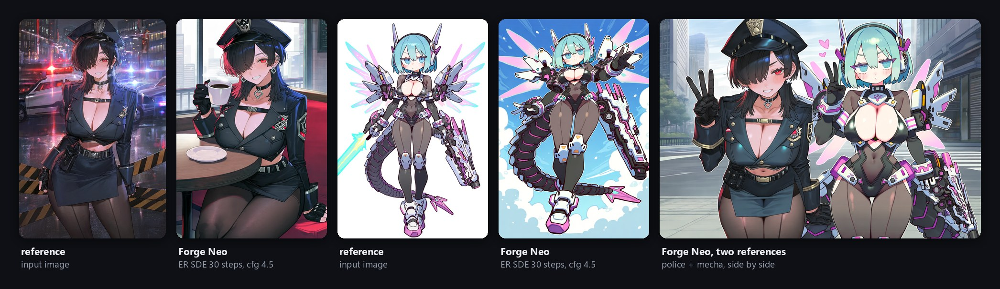

<div align="center">


# Anima Reference Adapter for Forge Neo

**参照画像からキャラクターと画風を、プロンプトからポーズ・場所・構図を。**

[](https://huggingface.co/ElectronGirl/anima-ref-adapter)
[](https://github.com/ElectronGirl/ComfyUI-Anima-Ref-Adapter)
[](https://github.com/ElectronGirl/anima-ref-adapter-research)
[](https://ko-fi.com/electrongirl)

[English](README.md) · [한국어](README.ko.md) · **日本語**

</div>

<br>

[Stable Diffusion WebUI Forge - Neo](https://github.com/Haoming02/sd-webui-forge-classic/tree/neo) で
[Anima Reference Adapter v2](https://huggingface.co/ElectronGirl/anima-ref-adapter) を使うための拡張機能です。
[Anima](https://huggingface.co/circlestone-labs/Anima) に参照画像1枚と、シーンだけを書いたプロンプトを渡すと、キャラクター
（髪、目、衣装、アクセサリー）と画風の多くは画像から、ポーズ・背景・構図はプロンプトから取り込みます。参照画像を
もう1枚加えると、2人のキャラクターを1枚に描けます。

この拡張機能で Forge Neo で生成した結果です（RTX 3060 Ti）:



作例、測定結果、仕組みは
[ComfyUI 版の README](https://github.com/ElectronGirl/ComfyUI-Anima-Ref-Adapter/blob/main/README.ja.md) にあります。この拡張機能は
同じアダプターを同じガイダンス方式で実行します。

> 資金不足のため、アダプターの開発は休止しています。追加学習の支援は **[Ko-fi](https://ko-fi.com/electrongirl)** からお願いします。

## インストール

1. Forge Neo で **Extensions → Install from URL** を開き、
   `https://github.com/ElectronGirl/sd-forge-anima-ref-adapter` を貼り付けて **Install** を押します。
   または `extensions/` に直接クローンします:
   ```bash
   cd sd-webui-forge-neo/extensions
   git clone https://github.com/ElectronGirl/sd-forge-anima-ref-adapter.git
   ```
2. Forge Neo を再起動します。
3. チェックポイントに Anima base v1.0 を選び、**VAE / Text Encoder** で `qwen_3_06b_base` と `qwen_image_vae` を
   選択します。拡張機能なしで Anima を使うときと同じです。

アダプターの重み（`anima_ref_adapter_v2_r64.safetensors`、183MB）は、拡張機能を有効にして初めて生成するときに、
LoRA フォルダーへ自動でダウンロードされます。

## 使い方

1. txt2img で **Anima Reference Adapter** パネルを開き、有効にします。
2. **Reference** に参照画像を入れます。
3. プロンプトには品質タグ、`1girl` か `1boy`、`solo`、そしてシーンだけを書きます:
   `masterpiece, best quality, score_7, safe, 1girl, solo, cowboy shot, sitting, cafe, holding cup, smile, looking at viewer, indoors, window, day`
   キャラクター名、絵師タグ、衣装タグは入れません。
4. 生成します。Anima のいつもの設定（ER SDE か Euler、30 steps、CFG 4.5）がそのまま使えます。

**2人のキャラクター:** **Second character (right, optional)** に2人目を入れると、1枚目の右側につながります。`solo` の
代わりに `2girls`（または `1boy, 1girl`）と書き、左と右がそれぞれ誰かを短く書き、1216x832 のような横長のサイズを
使います。

| 設定 | 既定値 | |
|---|---|---|
| Reference guidance | 4.5 | 参照画像に寄せる強さです。1 では追加のモデル呼び出しがなく、速いですが弱くなります。 |
| Correction | `apg` | ガイダンスが強いときの色の行き過ぎを抑えます。`rescale`、`none` もあります。 |
| Reference guidance end | 1.0 | サンプリングのこの時点で追加のガイダンスを止めます。0.6 前後でほぼ同じ画像をより速く得られます。 |
| Reference size (MP) | 1.0 | 参照画像をこの面積に合わせます。VRAM が足りないときは下げます。 |

設定値は画像の infotext（`anima_ref_*`）に保存されます。

**turbo LoRA:** プロンプトに Anima base 用の turbo LoRA を入れ（例: `<lora:anima-turbo-lora-v0.2:1>`）、10 steps、CFG 1、
Reference guidance 1 にします。

## メモリ

キャッシュした参照画像は 1MP で VRAM を約 1GB 使い、拡張機能はこの分を Forge のメモリ管理にあらかじめ予約します。
ほかのプログラムと共有している 8GB の GPU で生成が非常に遅くなる場合（コンソールに空きメモリ不足の警告が出ます）は、
Forge を `--reserve-vram 2` で起動するか、参照画像のサイズを下げてください。

## API

常時有効なスクリプト（always-on script）なので、`/sdapi/v1/txt2img` からも使えます:

```json
"alwayson_scripts": {
  "anima reference adapter": {
    "args": [true, "<reference as base64>", "", "anima_ref_adapter_v2_r64.safetensors", 4.5, "apg", 1.0, 1.0]
  }
}
```

引数は順に、有効かどうか、参照画像（base64）、2枚目の参照画像（base64 または `""`）、アダプターのファイル、
Reference guidance、Correction、Reference guidance end、参照画像のサイズ（MP）です。

## 補足

- Forge Neo `neo-2.31`（PyTorch 2.14、CUDA 13.0）、RTX 3060 Ti 8GB の txt2img で動作を確認しています。img2img と
  hires fix は未検証です。
- 対応しているのは v2 アダプターだけです。パイロット版アダプターには ComfyUI のノードが必要です。
- チェックポイントは Anima である必要があります。ほかのモデルではパネルは何もしません。

## ライセンス

拡張機能のコードは **Apache-2.0**（[LICENSE](LICENSE)）です。アダプターの重みは CircleStone Model の派生物で、
Hugging Face で **CircleStone Non-Commercial License** のもとで配布しています。このプロジェクトは CircleStone Labs や
Forge Neo の開発者とは関係がなく、その保証も受けていません。
